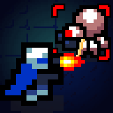

# Robot Warfare: Dead Signal

A pocket squad-tactics game for your phone. Kestrel Squad drops into a city overrun by robot insects to find a missing radio operator, fight to a helipad, and hold it until the dropship arrives. Something big lives under the streets.



### ▶ [Play now: dianteclark.github.io/ATinyExp](https://dianteclark.github.io/ATinyExp/)

Best on a phone held upright. Use **Add to Home Screen** to install it with the app icon.

## Play

The live link above is served by GitHub Pages from `main` (root folder). You can also open `index.html` directly in a browser: it's one self-contained file and works offline. It plays in portrait, and turning the phone sideways shows a "turn your phone upright" screen.

### Controls

| | Phone | Desktop |
|---|---|---|
| Select soldier | Tap soldier or squad badge | Click |
| Move / fire / throw | Tap once to preview, tap again to confirm | Click |
| Pan | Drag | Right-drag or WASD |
| Zoom | Pinch, or the + / − buttons | Mouse wheel, + / − keys |
| End turn | END button | END or Space |

Each soldier gets one move and one action per turn. Cover from cars, rocks and walls cuts enemy aim by 20 (half) or 40 (full). Overwatch fires at the first enemy that moves in range. Shoot fuel barrels to set them off.

**Downed, not dead.** A soldier at 0 HP goes down and bleeds out after 3 turns. Move a squadmate next to them and tap the downed soldier to revive them with 3 HP; it costs that squadmate's action. Anyone still down when the dropship arrives is carried out.

**Scrap and upgrades.** Destroyed robots, supply caches (the bobbing **!** on the map) and finishing the mission earn scrap. Spend it in the **Barracks** (title screen or after a mission) on Health, Damage, Move and Aim for each soldier. The machine gunner's damage upgrades add rounds instead. Progress is saved in your browser.

## Project layout

```
index.html              built game (generated, do not edit by hand)
manifest.webmanifest    install info: name, icons, portrait
icons/                  app icon (512/192/180/64) + favicon
src/                    game source
  core.js               canvas, scaling + zoom, input, audio, MIDI chiptune synth
  map.js                map layout, tiles, line of sight, cover, pathfinding
  units.js              soldier/robot stats, animation, effects, lights
  game.js               turns, combat, enemy AI, mission script + dialogue
  ui.js                 HUD, dialogue box, title/end screens, lighting, main loop
assets/                 processed art/audio the game ships with
tools/
  prepare_assets.py     raw asset packs -> assets/ (trims + converts audio, converts MIDI)
  make_icons.py         builds the app icon from the pack's sprites
  build.py              bundles src/ + assets/ into index.html
tests/
  smoke.py              headless phone/landscape/desktop checks with screenshots
  bot_run.py, bot.js    autoplay bot that plays N turns looking for crashes
```

### Building

```
python3 tools/build.py            # after editing src/ -> regenerates index.html
python3 tools/make_icons.py       # regenerate icons
python3 tools/prepare_assets.py /path/to/raw-packs   # only if the source packs change
```

Tests need `pip install playwright` and a Chrome binary:

```
python3 tests/smoke.py /tmp/shots
python3 tests/bot_run.py 25
```

## Credits

- **Pixel art:** [Robot Warfare Asset Pack](https://mattwalkden.itch.io/free-robot-warfare-pack) by Matt Walkden. CC0.
- **Voices:** Super Dialogue Audio Pack v1 by Dillon Becker, performed by Ian Lampert, Sean Lenhart, Alex Brodie, Meghan Christian and Karen Cenon. Licensed [CC BY 4.0](https://creativecommons.org/licenses/by/4.0/). The clips were trimmed and converted to MP3.
- **Sound effects:** 400 Sounds Pack and 96 Extra SFX.
- **Music:** MIDI tracks (Military Base, Dark Factory, Battle Theme, The Evil One, Malicious Scheme) played live through an in-browser chiptune synth.
- The bitmap font is Pillow's built-in bitmap font.

The raw asset packs aren't committed because of their size. Only the trimmed files the game uses are in `assets/`.
